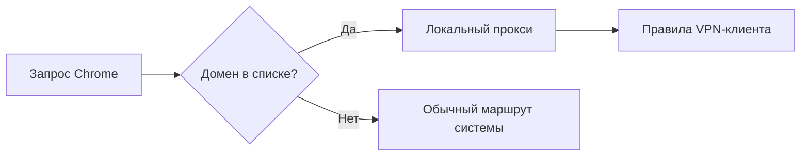

# Site Proxy Switcher

Расширение Chrome, которое отправляет выбранные сайты через локальный HTTP- или SOCKS5-прокси. Для остальных сайтов действует обычный сетевой маршрут. YouTube добавляется вместе с доменами видеопотока, превью и API.

## Быстрый старт

1. Распакуй архив. В Chrome открой `chrome://extensions`, включи «Режим разработчика» и загрузи папку `extension` через «Загрузить распакованное расширение».
2. Открой меню расширения и нажми «Настроить прокси». Вставь адрес своего локального входа, например `http://127.0.0.1:7890` или `socks5://127.0.0.1:10808`, и нажми «Сохранить». Это примеры адресов, фактический порт указан в твоём VPN-клиенте.
3. На нужном сайте открой меню расширения и нажми «Добавить в список». Список действует на все обычные вкладки этого профиля Chrome. Сторонние домены на той же странице следуют своим правилам.

Для проверки рядом с другим расширением прокси используй отдельный профиль Chrome. Chrome применяет одну эффективную конфигурацию прокси на профиль. [Настройки Chrome](https://developer.chrome.com/docs/extensions/reference/api/types#scope-and-lifecycle)

## Автоопределение на Windows

1. Запусти `Install-Discovery.cmd`. Скрипт соберёт помощник из `native/` системным компилятором .NET Framework и зарегистрирует его только в текущей учётной записи Windows.
2. Подключись в VPN-клиенте. В настройках расширения нажми «Найти локальный прокси» и подтверди доступ Chrome к помощнику.
3. Проверь название клиента и адрес. Нажми «Использовать» на подходящем варианте. Помощник завершится после ответа. При обычной работе открытое окно CMD не нужно.

| Клиент | Что используется для поиска |
| --- | --- |
| Koala Clash | Порты HTTP и mixed из локального интерфейса Mihomo, подтверждение владельца порта, приветствие SOCKS5 |
| Clash Verge Rev | Владелец порта и приветствие SOCKS5. Порты Mihomo подхватываются через стандартный именованный канал, если он доступен |
| Happ | Порты запущенного клиента или его ядра, ответ SOCKS5. HTTP также распознаётся по системному прокси Windows или ответу 407 |
| v2rayN | Порты запущенного клиента или его ядра, ответ SOCKS5. HTTP также распознаётся по системному прокси Windows или ответу 407 |

Автоопределение находит локальный вход. Политику выхода задаёт VPN-клиент. Один клиент может открыть несколько портов и направлять их по-разному. Для нестандартного HTTP-порта, который поиск пропустил, используй ручной ввод. Chrome поддерживает SOCKS5 без пароля. Для входа с авторизацией проверь доступность HTTP-прокси. [Порты Mihomo](https://wiki.metacubex.one/en/config/inbound/port/) · [Прокси в Chrome](https://chromium.googlesource.com/chromium/src/+/main/net/docs/proxy.md#proxy-server-schemes)

Системный VPN влияет и на сайты вне списка. Загляни в настройки маршрутов клиента, если важно, куда они выходят.

## Безопасность

У расширения нет телеметрии. Оно хранит только выбранный локальный прокси и список доменов в профиле Chrome. Запрос на автоопределение содержит только команду `discover`. Ответ содержит найденные локальные адреса и протоколы. Правила и угрозы разобраны в [SECURITY.md](SECURITY.md).

## Удаление

Удаление расширения в `chrome://extensions` снимает его настройку прокси. `Uninstall-Discovery.cmd` отдельно удаляет регистрацию помощника и его файлы. Настройки VPN-клиентов управляются в самих клиентах.

## Проверка версии 0.1.0

- В отдельном профиле Chrome проверены ручная настройка HTTP и SOCKS5, маршруты YouTube, список сайтов, снятие настройки прокси и отклонение удалённых адресов.
- Детектор подтвердил фактические порты запущенной Koala Clash. Happ, Clash Verge Rev и v2rayN представлены локальными имитациями, которые проверяют определение владельца, SOCKS5 и признаки авторизации. Совместимость с реальными установками этих трёх клиентов ещё предстоит проверить.
- Обработка сообщений Native Messaging проверена с тестовым манифестом. Регистрация в Windows и разрешение в рабочем Chrome оставлены для проверки установки.

## Структура

- `extension/` — браузерный интерфейс и PAC-правила маршрутизации.
- `native/` — компактный Windows-помощник на C#.
- `Install-Discovery.cmd`, `Uninstall-Discovery.cmd` — регистрация и удаление помощника для текущего пользователя.
