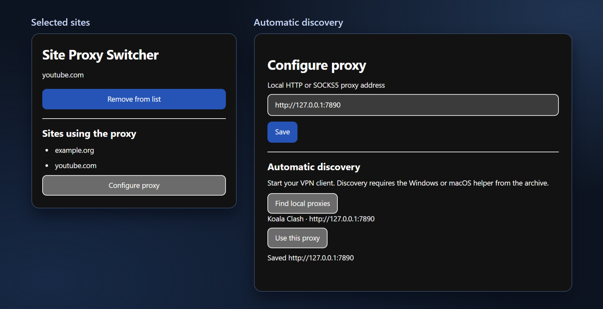

<h1 align="center">Site Proxy Switcher</h1>

  <strong>Use your local proxy for selected sites in Chrome</strong> 
  Pick the sites. Chrome sends their requests to your local HTTP or SOCKS5 proxy.

  <a href="https://github.com/tacohed393/site-proxy-switcher/releases/download/v0.2.0/site-proxy-switcher-0.2.0-source.zip"><strong>Download ZIP v0.2.0</strong></a>
  &nbsp;·&nbsp; <a href="docs/find-port.md">Find your proxy port</a>
  &nbsp;·&nbsp; <a href="SECURITY.md">Security</a>
  &nbsp;·&nbsp; <a href="README.ru.md">Русский</a>

  

## Install

1. [Download and extract the ZIP](https://github.com/tacohed393/site-proxy-switcher/releases/tag/v0.2.0). Open `chrome://extensions`, turn on **Developer mode**, select **Load unpacked**, and choose the `extension` folder.
2. Open **Configure proxy** from the extension menu. Enter your client's local address, such as `http://127.0.0.1:7890` or `socks5://127.0.0.1:10808`. [Find the right port](docs/find-port.md).
3. Open a site and click **Add to list**. The rule applies across regular tabs in this Chrome profile. Adding YouTube includes its video, thumbnail, and API domains.

Chrome picks the interface language. English is the default, and Russian is available when Chrome's interface uses Russian.

## Automatic discovery

Manual entry works on Windows and macOS with no helper. For discovery, install the helper once, start your VPN client, then select **Find local proxies** → **Use this proxy**.

| Platform | Install | Uninstall |
| --- | --- | --- |
| Windows | Run `Install-Discovery.cmd` from the extracted folder | Run `Uninstall-Discovery.cmd` |
| macOS (experimental) | In Terminal, from the extracted folder run `sh ./Install-Discovery-macOS.sh` | Run `sh ./Uninstall-Discovery-macOS.sh` |

Windows uses the system .NET Framework compiler. The optional macOS helper needs Python 3.8+ available as `python3`. Both helpers run as the current user and exit after returning results.

Discovery looks for Koala Clash, Happ, Clash Verge Rev and v2rayN. On macOS, a helper run under your account may miss a listener owned by a privileged service or an HTTP-only proxy that the client hasn't registered in system settings. Use [manual entry](docs/find-port.md) if your client or port is missing. Your VPN client decides where the proxy sends traffic.

## Security

- The list of sites and proxy address stay in the Chrome profile. There is no telemetry.
- Chrome asks for a separate discovery permission. The helper checks loopback ports and leaves VPN subscriptions unread.
- Selected sites have no direct fallback if the saved proxy goes offline. While the extension controls Chrome's proxy setting, other sites use Chrome's direct route. System-wide VPN routing can still apply.

Read the [security model and reporting instructions](SECURITY.md).

## Remove

Remove the extension from `chrome://extensions` to clear its proxy setting. If you installed a helper, run the uninstall command for your platform. To update an unpacked installation, replace its extension files with the new version and click **Reload** on its card.

What has been tested

- HTTP and SOCKS5 routing rules, YouTube, the selected-site list, clearing proxy settings and loopback-only input validation were checked in a separate Chrome profile on Windows.
- Windows discovery was tested with Koala Clash and local fixtures for Happ, Clash Verge Rev and v2rayN.
- macOS discovery was checked with simulated system output, loopback tests, and test registration files. Installation and discovery in Chrome on a Mac still need a real-device test.

