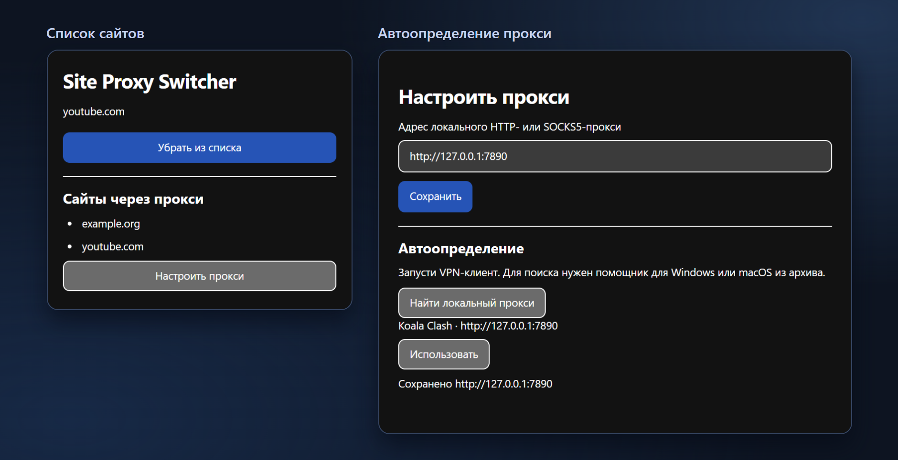

<h1 align="center">Site Proxy Switcher</h1>

  <strong>Локальный прокси для выбранных сайтов в Chrome</strong> 
  Добавь сайты в список, и Chrome будет отправлять их запросы через твой HTTP- или SOCKS5-прокси.

  <a href="https://github.com/tacohed393/site-proxy-switcher/releases/download/v0.2.0/site-proxy-switcher-0.2.0-source.zip"><strong>Скачать ZIP v0.2.0</strong></a>
  &nbsp;·&nbsp; <a href="docs/find-port.ru.md">Как найти порт</a>
  &nbsp;·&nbsp; <a href="SECURITY.ru.md">Безопасность</a>
  &nbsp;·&nbsp; <a href="README.md">English</a>

  

## Установка

1. [Скачай и распакуй архив](https://github.com/tacohed393/site-proxy-switcher/releases/tag/v0.2.0). В `chrome://extensions` включи **Режим разработчика**, нажми **Загрузить распакованное расширение** и выбери папку `extension`.
2. Открой **Настроить прокси** в меню расширения. Введи локальный адрес из своего клиента, например `http://127.0.0.1:7890` или `socks5://127.0.0.1:10808`. [Как найти нужный порт](docs/find-port.ru.md).
3. Открой сайт и нажми **Добавить в список**. Правило действует во всех обычных вкладках этого профиля Chrome. YouTube добавляется вместе с доменами видео, превью и API.

Язык расширения определяется языком интерфейса Chrome. Для русского Chrome доступна русская версия. По умолчанию используется английский.

## Автоопределение

Ручной ввод работает на Windows и macOS без помощника. Для поиска установи помощник один раз, запусти VPN-клиент и нажми **Найти локальный прокси** → **Использовать**.

| Система | Установка | Удаление |
| --- | --- | --- |
| Windows | Запусти `Install-Discovery.cmd` из распакованной папки | Запусти `Uninstall-Discovery.cmd` |
| macOS (экспериментально) | В Терминале из распакованной папки выполни `sh ./Install-Discovery-macOS.sh` | Выполни `sh ./Uninstall-Discovery-macOS.sh` |

На Windows помощник собирается системным компилятором .NET Framework. Для помощника на macOS нужен Python 3.8+ с командой `python3`. Оба помощника запускаются от текущего пользователя и завершаются после выдачи результата.

Поиск рассчитан на Koala Clash, Happ, Clash Verge Rev и v2rayN. На macOS он может пропустить порт, открытый службой с повышенными правами, или HTTP-прокси, который клиент не прописал в настройках системы. Если нужного порта нет в выдаче, [введи его вручную](docs/find-port.ru.md). Куда прокси отправит трафик, решает VPN-клиент.

## Безопасность

- Список сайтов и адрес прокси хранятся в профиле Chrome. Телеметрии нет.
- Для поиска Chrome запрашивает отдельное разрешение. Помощник проверяет локальные порты и не читает VPN-подписки.
- При недоступном порте сайты из списка остаются без запасного прямого маршрута. Пока расширение управляет настройкой прокси, остальные сайты используют прямой маршрут Chrome. На них по-прежнему может влиять системный VPN.

[Разрешения, границы защиты и сообщения об уязвимостях](SECURITY.ru.md).

## Удаление

Удали расширение в `chrome://extensions`, чтобы снять его настройки прокси. Если ставил помощник, запусти команду удаления для своей системы. Чтобы обновить распакованное расширение, замени его файлы новой версией и нажми **Обновить** на его карточке.

Что проверено

- Правила HTTP и SOCKS5, YouTube, список сайтов, снятие настройки прокси и проверка локального адреса тестировались в отдельном профиле Chrome на Windows.
- Детектор Windows проверен на Koala Clash и локальных имитациях Happ, Clash Verge Rev и v2rayN.
- Для помощника macOS проверены обработка примеров системного вывода, локальные соединения и файлы регистрации. Установка и поиск в Chrome на реальном Mac ещё не проверены.

